# MXBMRP3 - Usage Survey Report

**Data window:** 2026-06-27 → 2026-10-24 (120 days, 103 observed)

Generated by `tools/analytics_report.py` from Aptabase exports - do not edit.

| At a glance | |
|---|--:|
| Unique installs | **18,733** |
| Downloads | **90,691** |
| Releases since Nov 2025 | **41** |
| Avg active/day | **2,409** |
| Launches | **946,776** |
| Countries | **108** |

*Unique installs: plugin copies that have reported since 1.26, each counted once however often it is updated. Downloads: installer and zip from GitHub, updates included.*

## Games

| Game | Installs | Launches | Share of launches |
|---|--:|--:|--:|
| MX Bikes | 18,465 | 935,465 | 98.8% |
| GP Bikes | 190 | 9,380 | 1.0% |
| Kart Racing Pro | 78 | 1,931 | 0.2% |

## Activity over time

> Daily charts omit partial export days (2026-06-27, 2026-10-24); totals include them.

Curves pool all games (GP Bikes and Kart Racing Pro are 1% of launches).

- **unique installs:** 18,733  ·  **avg new installs/day:** 180 (over the last 30 full days)

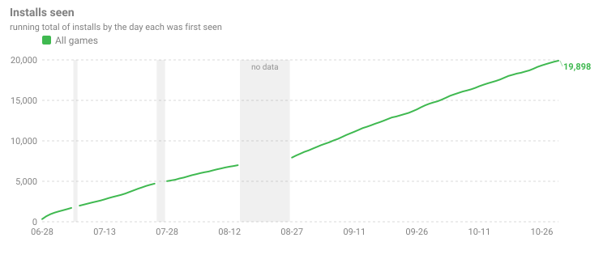

- **share of a day's active installs that are new:** 5% (over the last 30 full days)

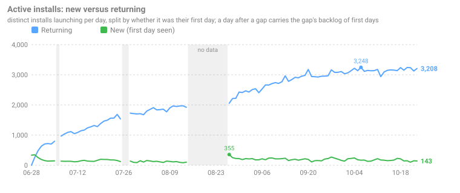

> The first weeks are existing users upgrading, not new ones; averages use the last 30 full days.

- **downloads:** 90,691  ·  **avg downloads/day:** 341 (over the last 16 days)

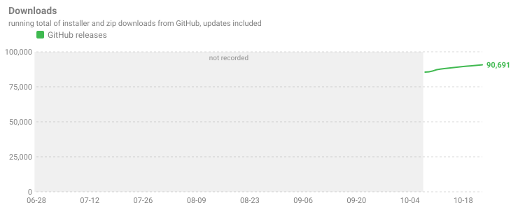

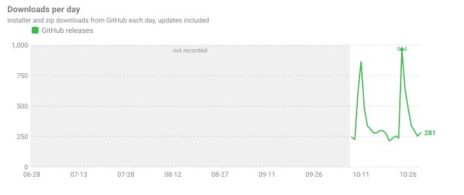

- **avg launches per active install:** 3.7  ·  **avg launches/day:** 8,967

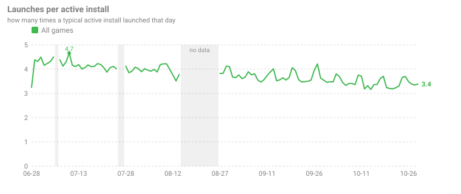

- **Busiest hour:** Sundays 19:00 UTC, 614 launches  ·  **quietest hour of the day:** 07:00 UTC, 183 launches

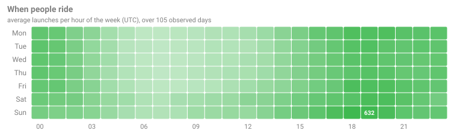

- **Median session:** 16 min  ·  **mean:** 36 min  ·  **617,124 sessions**
- **About 374,000 hours** in total; sessions left open pull the mean above the median.

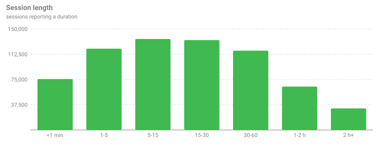

## Retention

- **Half** of new installs are still playing with the plugin a month later: 65% after a week, 47% after a month, of 11,742 installs old enough to measure.
- **77% come back after their first day;** after the first week the curve is nearly flat.

> A floor: an install that stops playing looks the same as one that removed the plugin. The report's first week (existing users arriving) is not counted.

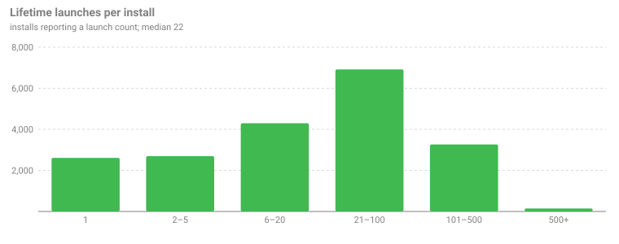

## Geography

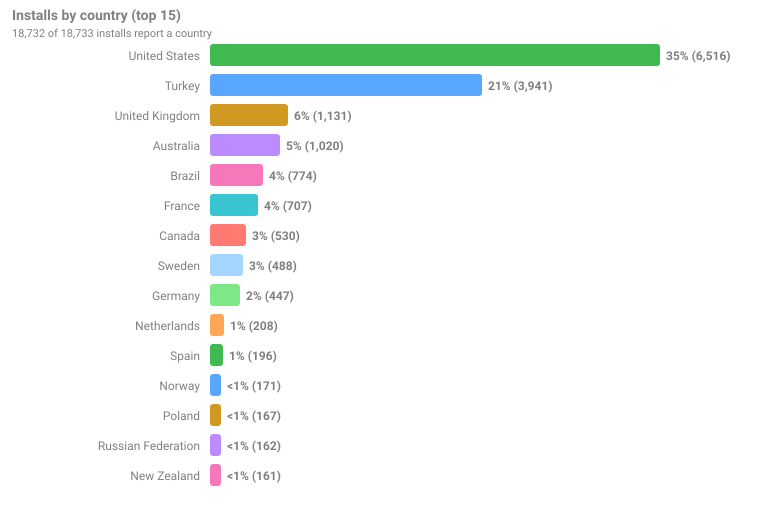

## Achievements

- **Achievement tiers earned, median per install:** 15%  ·  **installs holding at least one achievement:** 97% (9,188 of 9,491)

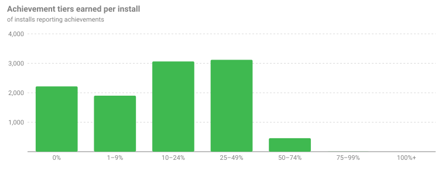

- **Achievements unlocked, median per install:** 22

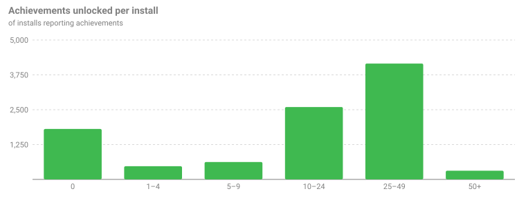

- **Earned so far:** 78 of the 82 listed achievements; the 32 hidden ones are under the fold below.

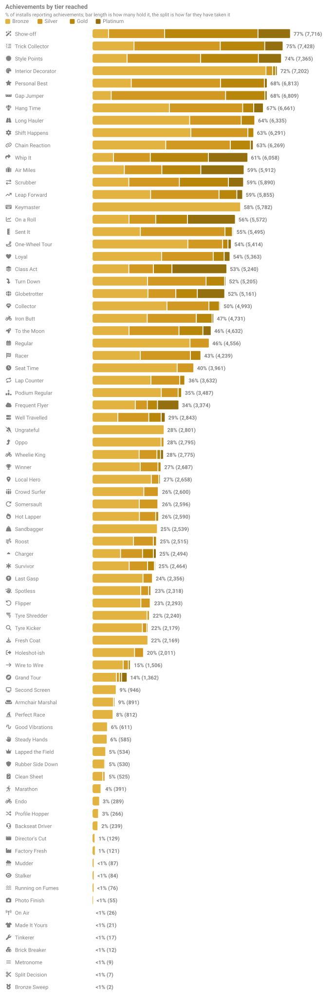

<b>Hidden achievements</b> - 31 of the 32 earned by anyone (spoilers)

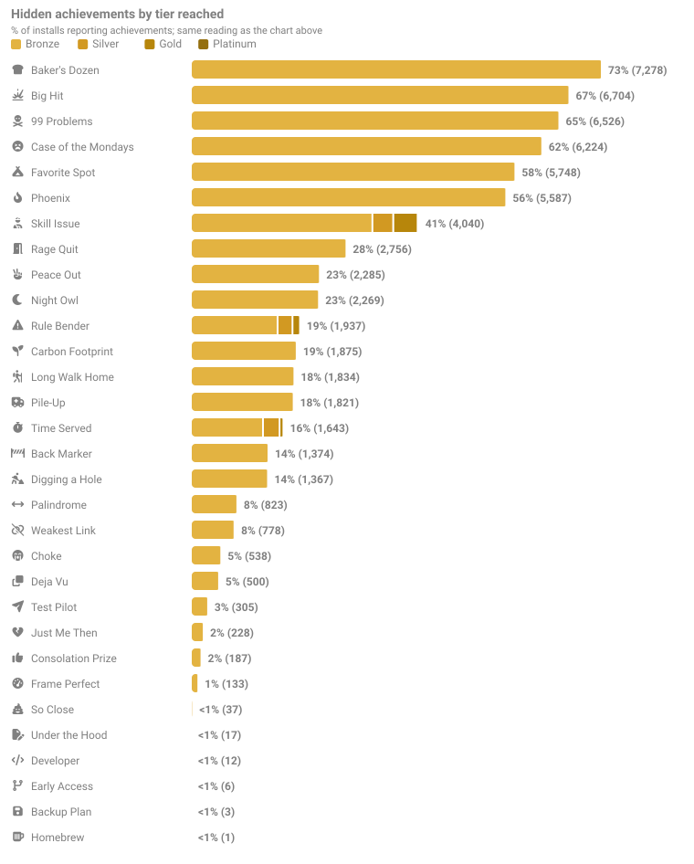

## Feature & HUD adoption - MX Bikes

MX Bikes only (18,465 installs). *(GP Bikes 190 and Kart Racing Pro 78 have too few for their own.)*

- **Median HUDs enabled per install:** 5  ·  **median widgets:** 7

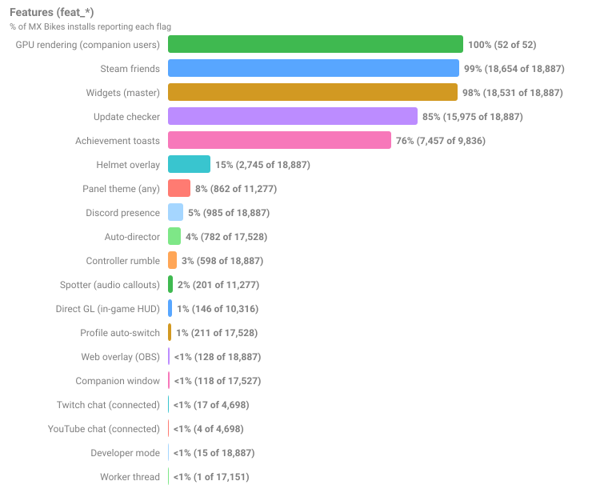

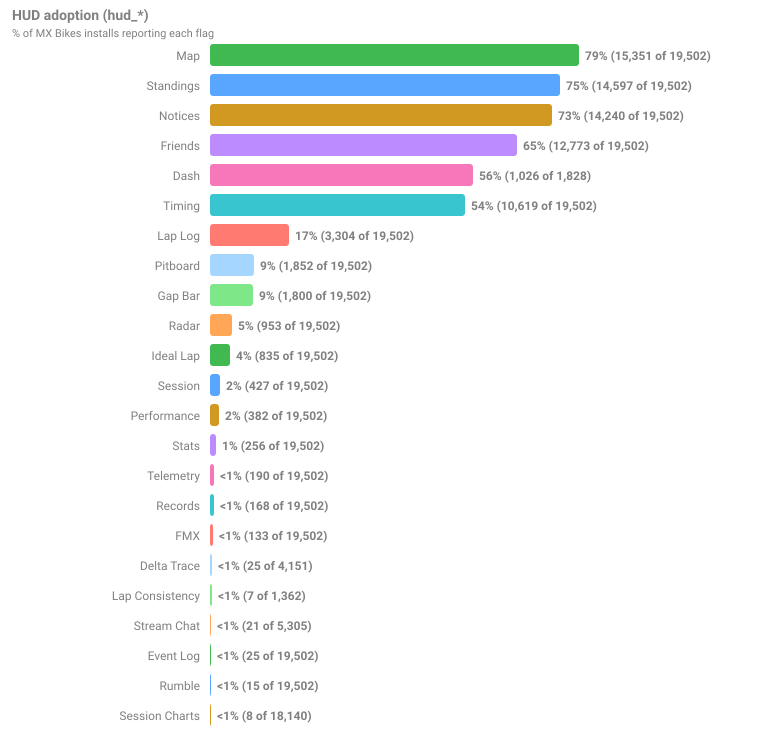

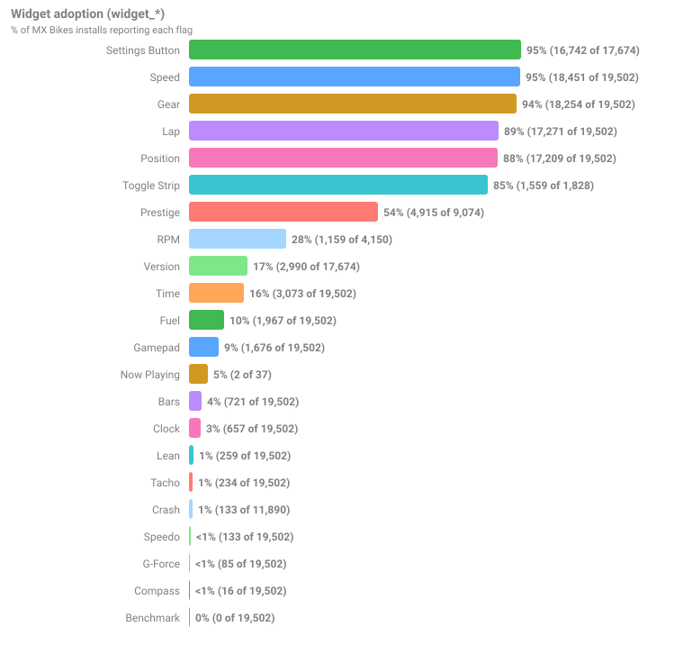

*Not charted: Pointer (always on); Spotter (follows the spotter, see Features).*

## Operating system

| OS | Installs |
|---|--:|
| Windows 11 | 77% (13,441) |
| Windows 10 | 21% (3,705) |
| Linux / Proton / Wine | 1% (197) |
| Other Windows | <1% (1) |

*17,344 of 18,733 installs report an OS*

## Plugin version adoption

Each install counts once, at its most recent version; 8 of 18,733 run the prerelease channel.

| Release line | Released | Unique installs | Downloads |
|---|--:|--:|--:|
| 1.32 | 2026-10-10 | 16% (3,053) | 4,761 |
| 1.31 | 2026-10-03 | 7% (1,279) | 3,255 |
| 1.30 | 2026-09-06 | 28% (5,174) | 9,691 |
| 1.29 | 2026-08-26 | 8% (1,476) | 6,056 |
| 1.28 | 2026-07-30 | 22% (4,163) | 5,462 |
| 1.27 | 2026-07-12 | 12% (2,199) | 7,641 |
| 1.26 | 2026-06-28 | 7% (1,389) | 3,856 |
| 1.25 | 2026-06-21 |  | 2,147 |
| 1.24 | 2026-06-14 |  | 2,435 |
| 1.23 | 2026-05-30 |  | 3,818 |
| 1.22 | 2026-04-26 |  | 6,578 |
| 1.21 | 2026-04-05 |  | 4,742 |
| 1.20 | 2026-03-30 |  | 1,574 |
| 1.19 | 2026-03-28 |  | 648 |
| 1.18 | 2026-03-22 |  | 368 |
| 1.17 | 2026-03-15 |  | 726 |
| 1.16 | 2026-03-08 |  | 1,217 |
| 1.15 | 2026-02-11 |  | 4,398 |
| 1.14 | 2026-01-24 |  | 5,608 |
| 1.13 | 2026-01-18 |  | 2,113 |
| 1.12 | 2026-01-11 |  | 3,202 |
| 1.11 | 2026-01-05 |  | 1,838 |
| 1.10 | 2025-12-29 |  | 1,950 |
| 1.9 | 2025-12-23 |  | 1,304 |
| 1.8 | 2025-12-16 |  | 1,183 |
| 1.7 | 2025-12-13 |  | 524 |
| 1.6 | 2025-12-09 |  | 1,210 |
| 1.5 | 2025-11-29 |  | 2,386 |
| **Total** |  | **18,733** | **90,691** |

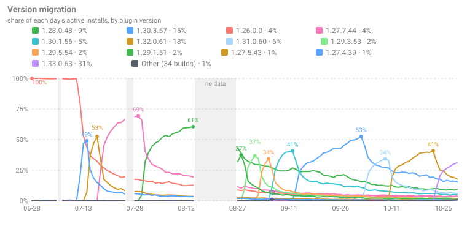

## Crashes (upstream / stability)

Analysed: **95,135** of **97,913** crash reports (1.27.5+ builds, full diagnostics). Excluded: 2,767 from earlier builds and 11 from dev tooling.

- **Affected installs:** 10,410 of 16,960 running 1.27.5+ (61%) sent at least one crash report

> Recorded faults landed **outside the plugin** (in the game or another module), not necessarily the root cause. [Known crashes](../crash_analysis/KNOWN_GAME_CRASHES.md) are grouped by cause, the rest by module.

### Crash rate by game

| Game | Installs | 1.27.5+ launches | Crash reports | Launches with a crash report |
|---|--:|--:|--:|--:|
| GP Bikes | 160 | 7,677 | 954 | 12.4% |
| Kart Racing Pro | 68 | 1,711 | 308 | 18.0% * |
| MX Bikes | 16,733 | 785,506 | 93,873 | 12.0% |

*\* Kart Racing Pro has 68 installs: a few machines can set this rate.*

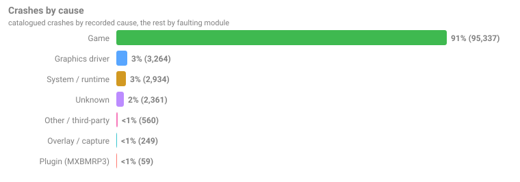

*The Plugin (MXBMRP3) slice (57 crashes) is where the fault landed, not proof the plugin caused it.*

| Access-violation type | Reports |
|---|--:|
| read | 79% (75,492) |
| write | 18% (16,822) |
| execute | 2% (2,218) |
| not recorded | <1% (603) |

### Most common crashes

**66% (63,031)** of reports match the [known-crash list](../crash_analysis/KNOWN_GAME_CRASHES.md).

| Crash | Share | Fix / workaround |
|---|--:|:--:|
| [Offline track-load crash (bad string in per-profile data)](../crash_analysis/KNOWN_GAME_CRASHES.md) | 32% (30,571) | [✔](../crash_analysis/KNOWN_GAME_CRASHES.md) |
| [Physics contact blow-up (bad table index)](../crash_analysis/KNOWN_GAME_CRASHES.md) | 17% (16,041) | - |
| [OpenGL render buffer write (vertex-fill overrun)](../crash_analysis/KNOWN_GAME_CRASHES.md) | 9% (8,134) | [✔](../crash_analysis/KNOWN_GAME_CRASHES.md) |
| [Session teardown null dereference (leaving a session / connecting)](../crash_analysis/KNOWN_GAME_CRASHES.md) | 7% (6,817) | - |
| [Session-teardown crash via input/message pump (stale pointer)](../crash_analysis/KNOWN_GAME_CRASHES.md) | <1% (637) | - |
| [Null dereference in network / session-end code](../crash_analysis/KNOWN_GAME_CRASHES.md) | <1% (500) | - |
| [Out-of-range array index read at session end](../crash_analysis/KNOWN_GAME_CRASHES.md) | <1% (330) | - |
| [64-bit pointer truncated to 32-bit (stack above 4 GB)](../crash_analysis/KNOWN_GAME_CRASHES.md) | <1% (1) | [✔](../crash_analysis/KNOWN_GAME_CRASHES.md) |

*✔ = a documented workaround.*

### Not yet catalogued

The other **34% (32,104)**, most frequent first. `unknown+0x0` is an address in no loaded module (likely freed memory).

| Fault (module + offset) | Category | Share |
|---|---|--:|
| `mxbikes.exe+0x22765c` | Game | 4% (3,971) |
| `mxbikes.exe+0x1d742c` | Game | 3% (2,602) |
| `unknown+0x0` | Unknown | 2% (2,180) |
| `mxbikes.exe+0x1a29ae` | Game | 2% (1,830) |
| `mxbikes.exe+0x255f1f` | Game | 1% (994) |
| `mxbikes.exe+0x1902be` | Game | <1% (832) |
| `mxbikes.exe+0x10ced3` | Game | <1% (757) |
| `MSVCR90.dll+0x3ec27` | System / runtime | <1% (754) |
| `mxbikes.exe+0x2889e0` | Game | <1% (728) |
| `mxbikes.exe+0x255ef0` | Game | <1% (727) |

## About this data

The plugin only sends anonymous, aggregate telemetry (no personal data - see the privacy note in the main README). Reporting began in **1.26** (a few stray older builds send only a basic launch event) and expanded through **1.27**, so older versions report fewer fields. Percentages are always taken over the installs that actually report a given field, and each chart notes how many installs that is, so incomplete rollout is never shown as a real trend.

**Definitions.** *Unique install* - a unique `install_id` (regenerated if the analytics file is deleted, so a wipe-and-reinstall reads as a new install). *Launch* - one plugin start (`app_started`). *Active install* - an install that launched on a given day. *Crash report* - one fault caught by the crash handler, saved on crash and sent on the next launch (≈ one per crashed launch). Each install belongs to one game (the plugin installs separately per game); its **game**, **country**, and **version** are its most recently seen values.

Developer/test machines are excluded report-wide (3 installs, 1,666 events): they launch every dev build and deliberately trigger crashes to validate the telemetry, which would otherwise read as phantom plugin crashes.

**Unidentified launches are excluded report-wide** (6,746 of them, 26% of what the install total would otherwise be, from at least 110 machines): a plugin whose analytics file had become unreadable minted a throwaway id on every launch, so each launch arrived as a brand-new install that never returned. Their launches go with them (1% of launches). The plugin now repairs the file, so this shrinks as those installs update.

What each release line reports (share of its launches):

| Release line | Launches | Features | HUDs / widgets | OS version | Update channel | Panel theme | Crash detail |
|---|--:|--:|--:|--:|--:|--:|--:|
| `1.25` | 1 | 0% | 0% | 0% | 0% | 0% | 0% |
| `1.26` | 126,020 | 100% | 100% | 0% | 100% | 0% | 0% |
| `1.27` | 173,365 | 100% | 100% | 100% | 100% | 0% | 85% |
| `1.28` | 189,554 | 100% | 100% | 100% | 100% | 0% | 100% |
| `1.29` | 110,201 | 100% | 100% | 100% | 100% | 100% | 100% |
| `1.30` | 247,283 | 100% | 100% | 100% | 100% | 100% | 100% |
| `1.31` | 44,828 | 100% | 100% | 100% | 100% | 100% | 100% |
| `1.32` | 55,524 | 100% | 100% | 100% | 100% | 100% | 100% |
